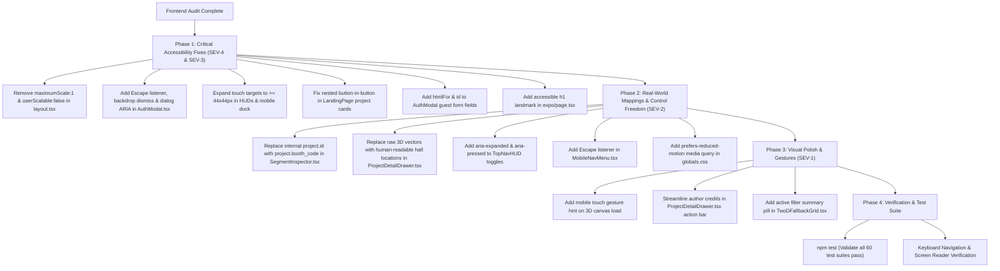

# Frontend Design & Usability Audit Report
**Delhi Public School Indirapuram (DPSI) Tech & Innovation Exhibition 2026**

**Scope:** Comprehensive frontend UI/UX, interaction design, accessibility (WCAG 2.1 AA), and responsiveness audit across all pages, 3D WebGL canvas components, interactive modals, and floating HUDs.  
**Audited Location:** `/Users/roopalisingh/Desktop/projects/dpsi-exhibition`  
**Live Target Deployment:** `https://dpsiexibition.pages.dev`  
**Interface Type:** Hybrid 3D Spatial Exhibition Hall (Three.js / React Three Fiber) & High-Density Web Application (Next.js App Router, Tailwind CSS, Framer Motion, Zustand).  
**Target Users:** Students (grades 6–12), parents, teachers, school administrators, jury evaluators, and mobile/desktop attendees.  
**Audit Standard:** 15 Usability Principles (Nielsen Norman Group, Constantine & Lockwood, Universal Design, WCAG 2.1 AA).

---

## Source Files Inspected
1. **Application Shell & Design System:**
   - `src/app/layout.tsx` (Viewport, fonts Outfit + Space Grotesk, custom cursor, theme initialization)
   - `src/app/globals.css` (Tailwind tokens, CSS custom properties, scrollbars, canvas touch rules)
   - `src/store/useExhibitionStore.ts` (Zustand state store, camera presets, navigation actions)
   - `src/components/ui/CustomCursor.tsx` & `src/components/reactbits/BlobCursor.tsx`
   - `src/components/ui/AmbientBackground.tsx` & `src/components/ui/ThemeSync.tsx`
2. **Page Views:**
   - `src/app/page.tsx` (Landing page, 35 inventions directory, arenas bento, schedule, live voting)
   - `src/app/expo/page.tsx` (Virtual 3D/2D Expo floor plan shell, skip links, ARIA live region)
   - `src/app/pass/page.tsx` (Apple Card CR-100 Delegate Pass Generator, gatekeeper, batch print, scanner)
3. **Interactive Modals, Drawers & Palettes:**
   - `src/components/ui/AuthModal.tsx` (Google OAuth & instant 1-click visitor pass)
   - `src/components/ui/DelegatePassModal.tsx` (6-digit credential gatekeeper modal)
   - `src/components/ui/SearchModal.tsx` (Cmd+K global search palette with keyboard navigation)
   - `src/components/ui/ProjectDetailDrawer.tsx` (Project inspector, high-res image lightbox, voting)
   - `src/components/ui/MobileNavMenu.tsx` (Mobile off-canvas navigation drawer)
   - `src/components/ui/LiveLeaderboard.tsx` (Real-time Olympic podium standings & vote shares)
4. **Floating HUDs & Interactive Canvas Components:**
   - `src/components/ui/TopNavHUD.tsx` (Floating desktop header navigation, zone tabs, sound/theme toggles)
   - `src/components/ui/MobileBottomDock.tsx` (Mobile action bar, zone scrubber, stepper)
   - `src/components/ui/CameraControlsWidget.tsx` (3D camera zoom & reset controls)
   - `src/components/ui/MinimapHUD.tsx` (SVG radar minimap tracking live camera and vision cone)
   - `src/components/ui/SegmentInspector.tsx` (Contextual segment card drawer)
   - `src/components/ui/TwoDFallbackGrid.tsx` (High-density accessible 2D directory fallback)
   - `src/components/canvas/WebGLErrorBoundary.tsx` (Crash boundary with auto 2D fallback & retry)
   - `src/components/canvas/GuidedTour.tsx` (6-stop automated camera tour controller)
   - `src/components/canvas/BoothMesh.tsx` (3D booth mesh geometry, interaction hitboxes, materials)
   - `src/components/canvas/ExhibitionCanvas.tsx` (Canvas shell, dynamic FPS monitor, context recovery)

---

## Executive Summary

| Severity Level | Count | Definition |
| :--- | :---: | :--- |
| **4 - Catastrophe** | **1** | Task-blocking or direct accessibility barrier (must fix immediately) |
| **3 - Major** | **5** | Significant user friction, standard violations, or broken mental models |
| **2 - Minor** | **7** | Noticeable friction, usability inconsistencies, or missing cues |
| **1 - Cosmetic** | **3** | Visual clutter, subtle visual polish, or duplicate credits |
| **Total Findings** | **16** | Evaluated across all 15 Usability Principles |

---

## Quick Wins (Highest-Impact, Low-Effort Fixes)

1. **Re-Enable Mobile Viewport Pinch-to-Zoom** (`src/app/layout.tsx:22-23`)  
   *Fix:* Remove `maximumScale: 1` and `userScalable: false` so visually impaired attendees can zoom into text on mobile phones.
2. **Add Escape Key & Backdrop Click Dismiss to AuthModal** (`src/components/ui/AuthModal.tsx:99-122`)  
   *Fix:* Add standard Escape key listener and backdrop click dismiss so users are never trapped in the voter verification popup.
3. **Fix Real-World Booth Code in SegmentInspector** (`src/components/ui/SegmentInspector.tsx:422`)  
   *Fix:* Display `project.booth_code` (`P01`, `D04`) instead of `project.id` (`physical-01`), eliminating confusion between digital labels and physical signs.
4. **Associate Form Labels with Input IDs in AuthModal** (`src/components/ui/AuthModal.tsx:318-347`)  
   *Fix:* Add `htmlFor` and matching `id` attributes on name and email fields for instant screen reader accessibility.
5. **Humanize 3D Spatial Coordinates in ProjectDetailDrawer** (`src/components/ui/ProjectDetailDrawer.tsx:357`)  
   *Fix:* Replace confusing raw 3D vectors (`[9.5, -4.5]`) with human-readable hall locations (`Zone 2 • Innovation Pod P04`).

---

## Principle-by-Principle Evaluation Matrix

| # | Usability Principle | Status | Summary of Evaluation |
| :-: | :--- | :---: | :--- |
| **1** | **Visibility of System Status** | Needs Improvement | Optimistic voting feedback and tour progress bars are excellent; audio toggles and search triggers lack live status announcements. |
| **2** | **Match Between System and Real World** | Needs Improvement | Physical booth blueprint aligns well; raw 3D engine coordinates and internal project slug IDs create real-world mismatches. |
| **3** | **User Control and Freedom** | Needs Improvement | 2D/3D toggle and tour controls are great; `AuthModal` and `MobileNavMenu` lack Escape key and backdrop dismissal. |
| **4** | **Consistency and Standards** | Needs Improvement | Brand colors and fonts are disciplined; modal backdrop opacities and icon libraries show slight divergence. |
| **5** | **Error Prevention** | Needs Improvement | Double-voting prevention and atomic rate limiting are robust; mobile form inputs lack `autoComplete` and `inputMode`. |
| **6** | **Recognition Over Recall** | Good | Booth badges and color coding are visible everywhere; missing feedback when invalid booth deep-link parameter is provided. |
| **7** | **Flexibility and Efficiency** | Good | Keyboard navigation (`Cmd+K`, Arrow keys, Enter) is top-tier; missing `prefers-reduced-motion` global handling. |
| **8** | **Aesthetic & Minimalist Design** | Good | Polished GitHub Universe aesthetic; duplicate credits and small visual clutter in mobile viewport need streamlining. |
| **9** | **Error Recovery** | Good | WebGL error boundary and OAuth redirect fallbacks are outstanding; missing retry button on network submission failures. |
| **10** | **Help and Documentation** | Needs Improvement | Desktop gesture legend is clear; mobile touchscreens lack touch gesture hints for 3D navigation. |
| **11** | **Affordances and Signifiers** | Needs Improvement | Booth hover cues and 3D pointer states work well; mobile tap targets on HUD buttons fall below the 44x44px minimum. |
| **12** | **Structure** | Good | Clear visual grouping and information hierarchy; `/expo` lacks a semantic `<h1>` landmark. |
| **13** | **Accessibility (WCAG 2.1 AA)** | **Violations** | Disabled viewport scaling, unassociated labels, missing `role="dialog"`, and focus trapping gaps in modals. |
| **14** | **Perceptibility** | Good | High-contrast glassmorphic HUDs preserve legibility over 3D scenes; search keyboard highlights lack ARIA selection states. |
| **15** | **Tolerance and Forgiveness** | Good | Access code verification is case-insensitive and trims whitespace; email input on landing page is not draft-persisted. |

---

## Detailed Findings & Concrete Code-Level Fixes

### Severity 4 — Catastrophic Issues

#### [SEV-4] Mobile Viewport Zoom Blocked via Metadata
- **Principle:** Principle 13 — Accessibility (WCAG 1.4.4 Resize text, Level AA)
- **Location:** `src/app/layout.tsx:22-23`
- **Issue:** The viewport metadata explicitly specifies `maximumScale: 1` and `userScalable: false`:
  ```ts
  export const viewport: Viewport = {
    width: 'device-width',
    initialScale: 1,
    maximumScale: 1,
    userScalable: false,
    viewportFit: 'cover',
    themeColor: '#070b14',
  };
  ```
- **User Impact:** Attendees, teachers, and parents with low vision are prevented from zooming in to read student project descriptions, team member names, and pass QR codes on their mobile devices.
- **Fix:** Remove `maximumScale` and `userScalable` to restore standard browser zoom functionality:
  ```diff
  --- a/src/app/layout.tsx
  +++ b/src/app/layout.tsx
  @@ -19,8 +19,6 @@ export const viewport: Viewport = {
     width: 'device-width',
     initialScale: 1,
  -  maximumScale: 1,
  -  userScalable: false,
     viewportFit: 'cover',
     themeColor: '#070b14',
   };
  ```

---

### Severity 3 — Major Usability & Accessibility Issues

#### [SEV-3.1] Missing Dialog Semantics, Backdrop Click Dismiss & Escape Key Handler in AuthModal
- **Principle:** Principle 3 — User Control and Freedom & Principle 13 — Accessibility
- **Location:** `src/components/ui/AuthModal.tsx:99-122`
- **Issue:** `AuthModal` overlay does not have `role="dialog"`, `aria-modal="true"`, or `aria-labelledby`. Clicking the backdrop overlay does not dismiss the modal, and pressing the Escape key does not trigger dismissal.
- **User Impact:** Visitors who accidentally trigger voter authentication or decide to cancel feel trapped when pressing Escape or clicking outside the card fails to close the dialog. Screen readers fail to announce the modal container.
- **Fix:**
  ```tsx
  // In src/components/ui/AuthModal.tsx:
  useEffect(() => {
    if (!isAuthModalOpen) return;
    const handleKeyDown = (e: KeyboardEvent) => {
      if (e.key === 'Escape') {
        setAuthError(null);
        setAuthModalOpen(false);
      }
    };
    window.addEventListener('keydown', handleKeyDown);
    return () => window.removeEventListener('keydown', handleKeyDown);
  }, [isAuthModalOpen, setAuthModalOpen]);

  // Update root container:
  <div
    role="presentation"
    onClick={(e) => {
      if (e.target === e.currentTarget) {
        setAuthError(null);
        setAuthModalOpen(false);
      }
    }}
    className="fixed inset-0 z-[9999] flex items-center justify-center p-3 sm:p-4 bg-slate-900/40 dark:bg-black/80 backdrop-blur-md"
  >
    <motion.div
      role="dialog"
      aria-modal="true"
      aria-labelledby="auth-modal-title"
      ...
    >
      <h2 id="auth-modal-title" className="text-lg sm:text-xl font-black text-slate-900 dark:text-white tracking-tight mt-0.5">
        Voter Verification
      </h2>
  ```

#### [SEV-3.2] Nested Interactive Elements in Project Cards (Button inside Button)
- **Principle:** Principle 11 — Affordances and Signifiers & Principle 13 — Accessibility
- **Location:** `src/app/page.tsx:854-870, 948-1008`
- **Issue:** The project card element is declared with `role="button"` and `tabIndex={0}`, yet it contains nested `<button>` tags (`Vote`, `Share`, `Details`) and a Next.js `<Link>` (`3D`).
- **User Impact:** Nested interactive controls violate HTML5 and ARIA specifications. Screen reader users hear nested button announcements and cannot predict what Enter or Space will activate. Keyboard navigation encounters invalid parent-child focus sequences.
- **Fix:** Convert the outer container to a semantic `<article>` without `role="button"` or `tabIndex={0}`. Attach the click handler to the card body or project title link instead, keeping action buttons as clean discrete focus targets.
  ```diff
  --- a/src/app/page.tsx
  +++ b/src/app/page.tsx
  @@ -854,8 +854,6 @@ export default function LandingPage() {
                 <div
                   key={p.id}
  -                role="button"
  -                tabIndex={0}
  -                onClick={() => selectProject(p)}
                   className={`group rounded-2xl border transition-all duration-200 flex flex-col justify-between overflow-hidden ${
  ```

#### [SEV-3.3] Undersized Touch Targets on Mobile Floating Controls (< 44x44px)
- **Principle:** Principle 11 — Affordances and Signifiers (WCAG 2.5.5 / 2.5.8 Target Size)
- **Location:**
  - `src/components/ui/TopNavHUD.tsx:307, 325, 377` (Buttons are `w-8 h-8` = 32x32px)
  - `src/components/ui/MobileBottomDock.tsx:170, 181, 229` (Buttons are `p-1.5 px-2` = 28-30px height)
  - `src/components/ui/CameraControlsWidget.tsx:34, 52, 64, 82` (Buttons are `w-8 h-8` = 32x32px)
  - `src/components/ui/ProjectDetailDrawer.tsx:251, 260` (Prev/Next buttons are `p-1.5` = 30px height)
- **User Impact:** On mobile devices, users frequently misclick adjacent buttons or miss small icon buttons (e.g. sound toggle, theme switch, zoom controls, navigation dock buttons), causing frustration.
- **Fix:** Update mobile button classes to maintain a minimum 44x44px hit-box using `min-w-[44px] min-h-[44px]` or `p-2.5`:
  ```tsx
  // Example for CameraControlsWidget & TopNavHUD buttons:
  className="w-9 h-9 sm:w-10 sm:h-10 min-w-[40px] min-h-[40px] flex items-center justify-center rounded-xl ..."
  ```

#### [SEV-3.4] Unassociated Form Labels in AuthModal Form
- **Principle:** Principle 13 — Accessibility & Principle 5 — Error Prevention
- **Location:** `src/components/ui/AuthModal.tsx:318-347`
- **Issue:** `<label>` tags for "Attendee or Judge Name" and "Email Address" do not have `htmlFor` attributes, and `<input>` elements lack matching `id` attributes:
  ```tsx
  <label className="block text-[11px] font-bold text-slate-700 dark:text-slate-300 mb-1.5">
    Attendee or Judge Name <span className="text-amber-500">*</span>
  </label>
  <input type="text" ... />
  ```
- **User Impact:** Screen readers fail to announce the label when inputs receive focus, and clicking the label text fails to set cursor focus in the text field.
- **Fix:** Add `htmlFor` and `id`, plus standard `autoComplete` attributes:
  ```diff
  --- a/src/components/ui/AuthModal.tsx
  +++ b/src/components/ui/AuthModal.tsx
  @@ -318,2 +318,2 @@
  -  <label className="block text-[11px] font-bold text-slate-700 dark:text-slate-300 mb-1.5">
  +  <label htmlFor="guest-name-field" className="block text-[11px] font-bold text-slate-700 dark:text-slate-300 mb-1.5">
       Attendee or Judge Name <span className="text-amber-500">*</span>
     </label>
     <div className="relative">
       <input
  +      id="guest-name-field"
         type="text"
         required
  +      autoComplete="name"
         placeholder="Enter your name"
  ```

#### [SEV-3.5] Missing Top-Level `<h1>` Landmark on `/expo`
- **Principle:** Principle 12 — Structure & Principle 13 — Accessibility
- **Location:** `src/app/expo/page.tsx:133-150`
- **Issue:** The main exhibition page lacks an `<h1>` heading in the DOM hierarchy.
- **User Impact:** Screen reader users relying on heading navigation (`H` key) cannot find the primary title or purpose of the page upon arrival.
- **Fix:** Insert a semantic screen-reader `<h1>` at the top of the `<main>` tag:
  ```tsx
  <h1 className="sr-only">
    DPS Indirapuram Tech & Innovation Exhibition 2026 — Interactive 3D Floor Plan
  </h1>
  ```

---

### Severity 2 — Minor Usability Friction & Consistency Gaps

#### [SEV-2.1] Internal Data ID Displayed Instead of Official Real-World Booth Code in SegmentInspector
- **Principle:** Principle 2 — Match Between System and Real World
- **Location:** `src/components/ui/SegmentInspector.tsx:421-423`
- **Issue:** The badge displays `project.id.toUpperCase()` (e.g. `PHYSICAL-01`, `DIGITAL-04`) instead of `project.booth_code` (`P01`, `D04`).
- **User Impact:** The physical school hall displays large signs for `P01`, `D04`, `B02`, `ST01`. Displaying `PHYSICAL-01` creates cognitive friction and breaks the mental model.
- **Fix:**
  ```diff
  --- a/src/components/ui/SegmentInspector.tsx
  +++ b/src/components/ui/SegmentInspector.tsx
  @@ -421,3 +421,3 @@
     <span className={`px-2 py-0.5 rounded-lg border font-mono text-[11px] font-bold ${catStyle.badge}`}>
  -    {project.id.toUpperCase()}
  +    {project.booth_code}
     </span>
  ```

#### [SEV-2.2] Raw Cartesian 3D Vectors Displayed to End-Users in ProjectDetailDrawer
- **Principle:** Principle 2 — Match Between System and Real World
- **Location:** `src/components/ui/ProjectDetailDrawer.tsx:357-359`
- **Issue:** Displays `Floor Coordinates: [${selectedProject.position_x}, ${selectedProject.position_z}]` (e.g. `[9.5, -4.5]`).
- **User Impact:** Visitors do not understand 3D Three.js game engine coordinates. They need physical navigation information (e.g., aisle and booth number).
- **Fix:**
  ```tsx
  <span>
    Location: Aisle {selectedProject.booth_code.charAt(0)} • Booth {selectedProject.booth_code} ({selectedProject.category})
  </span>
  ```

#### [SEV-2.3] Missing `aria-expanded` and `aria-pressed` States on HUD Toggles
- **Principle:** Principle 1 — Visibility of System Status & Principle 14 — Perceptibility
- **Location:** `src/components/ui/TopNavHUD.tsx:260, 313, 375`
- **Issue:** The sound toggle button lacks `aria-pressed`, the mobile hamburger menu lacks `aria-expanded`, and the leaderboard trigger lacks `aria-expanded`.
- **User Impact:** Screen reader users have no indication of whether sound effects are on/off, or whether navigation menus are currently expanded.
- **Fix:**
  - Add `aria-pressed={isSoundOn}` to the sound button.
  - Add `aria-expanded={isMobileMenuOpen}` to the mobile menu hamburger.
  - Add `aria-expanded={isLeaderboardOpen}` to the leaderboard button.

#### [SEV-2.4] Missing Escape Key Handler in MobileNavMenu
- **Principle:** Principle 3 — User Control and Freedom
- **Location:** `src/components/ui/MobileNavMenu.tsx:27-43`
- **Issue:** `MobileNavMenu` lacks an Escape key event listener.
- **User Impact:** Keyboard users on mobile devices or tablets cannot press Escape to close the full-screen menu overlay.
- **Fix:** Add `useEffect` listener for `keydown` (Escape key) that calls `setMobileMenuOpen(false)`.

#### [SEV-2.5] Lack of Global `prefers-reduced-motion` Respect on Infinite Animations
- **Principle:** Principle 7 — Flexibility and Efficiency & Principle 14 — Perceptibility
- **Location:** `src/app/globals.css`, `src/app/page.tsx:662-685` (`TextLoop`), `GuidedTour.tsx:73`
- **Issue:** Infinite rotating animations (`animate-spin`, marquee ribbon, 3D particles) run continuously even if the user has requested reduced motion in their operating system.
- **User Impact:** Users with vestibular disorders or motion sickness experience nausea from continuous animated movement.
- **Fix:** Add global reduced motion media queries in `src/app/globals.css`:
  ```css
  @media (prefers-reduced-motion: reduce) {
    *, ::before, ::after {
      animation-duration: 0.01ms !important;
      animation-iteration-count: 1 !important;
      transition-duration: 0.01ms !important;
      scroll-behavior: auto !important;
    }
  }
  ```

#### [SEV-2.6] Low Contrast on Secondary Captions in Light & Dark Themes
- **Principle:** Principle 13 — Accessibility & Principle 8 — Aesthetic and Minimalist Design
- **Location:** `src/app/page.tsx:516, 776`, `src/components/ui/SearchModal.tsx:119`
- **Issue:** `text-slate-400` on light background (`#dfe3e8` / `#f8fafc`) yields a contrast ratio of ~2.8:1, failing the WCAG AA minimum of 4.5:1 for body and placeholder text.
- **User Impact:** Elderly visitors, students, and attendees in bright auditorium lighting have difficulty reading search placeholders and technical metadata.
- **Fix:** Upgrade light mode secondary text and placeholders to `text-slate-600` or `placeholder-slate-500` to guarantee a >= 4.5:1 contrast ratio.

#### [SEV-2.7] Nested Interactive Controls on Image Lightbox Trigger
- **Principle:** Principle 11 — Affordances and Signifiers
- **Location:** `src/components/ui/ProjectDetailDrawer.tsx:321-373`
- **Issue:** The image container `div` has `onClick={() => setIsLightboxOpen(true)}` and `cursor-zoom-in`, but contains nested interactive elements (`Fullscreen` button and `Locate in 3D` link).
- **User Impact:** Clicking near the edge of the image can accidentally trigger the 3D relocation link or fullscreen button due to overlapping tap areas.
- **Fix:** Remove `onClick` from the container `div` and let the dedicated "Fullscreen" button and "Locate in 3D" link serve as explicit, clear action targets.

---

### Severity 1 — Cosmetic & Polish Opportunities

#### [SEV-1.1] Missing Touch Gesture Hints for First-Time Mobile 3D Visitors
- **Principle:** Principle 10 — Help and Documentation
- **Location:** `src/app/expo/page.tsx:177-200`
- **Issue:** The bottom camera gesture legend is marked `hidden lg:flex`. Mobile visitors see no guidance on touch navigation (e.g. 1-finger orbit, 2-finger pinch).
- **Fix:** Add a temporary subtle tooltip or gesture badge on mobile load that auto-dismisses after 5 seconds: `"Drag with 1 finger to rotate • Pinch to zoom"`.

#### [SEV-1.2] Repetitive Author Credits in Primary Conversion Zone
- **Principle:** Principle 8 — Aesthetic and Minimalist Design
- **Location:** `src/components/ui/ProjectDetailDrawer.tsx:471-473`
- **Issue:** Author credit text is placed directly underneath the vote counter in the project detail drawer action bar, competing with the primary "Cast Verified Vote" CTA.
- **Fix:** Keep author credits in the application footer and "About" dialog, leaving the voting action bar clean and focused.

#### [SEV-1.3] Missing Active Filter Summary in 2D Fallback Grid
- **Principle:** Principle 6 — Recognition Over Recall
- **Location:** `src/components/ui/TwoDFallbackGrid.tsx:150-166`
- **Issue:** When a category filter is selected, there is no quick tag showing the active filter name and a 1-click "Clear" button above the grid.
- **Fix:** Add an active filter tag pill with count and clear button above the project grid.

---

## Major Frontend Strengths & Best Practices

1. **Seamless Dual-Mode Spatial Engine with Resilient WebGL Crash Recovery (Principles 3, 9, 13)**  
   The application implements a world-class hybrid architecture: a full 3D spatial WebGL exhibition floor with hardware-accelerated OrbitControls, paired with an instant, accessible 2D Bento Directory fallback (`TwoDFallbackGrid`). The `WebGLErrorBoundary` automatically detects disabled hardware acceleration or GPU context loss, sets user-friendly notices, and switches cleanly to 2D view with a "Retry 3D" button. An accessible skip link (`Skip to 2D Floor Plan Grid`) on `/expo` allows keyboard and screen reader users to bypass the 3D canvas entirely.

2. **Atomic Ballot Security, Anti-Tamper Verification & Delightful Micro-Interactions (Principles 1, 5, 14)**  
   The voting flow balances zero-friction voter access with high security. It combines hardware-fingerprinted single-device voting, optional Google OAuth authentication, and instant optimistic UI updates accompanied by confetti bursts, haptic feedback, and audio chimes. The `LiveLeaderboard` features an Olympic podium with gold, silver, and bronze pedestals and relative vote-share comparison bars.

3. **High-Precision Wayfinding & Power-User Keyboard Efficiency (Principles 1, 6, 7, 10)**  
   Wayfinding is supported through an SVG radar minimap (`MinimapHUD`) tracking live camera coordinates and vision cone angles in real-time, an interactive 6-stop Guided Tour with play/pause and progress scrubbing, deep-linking support (`?booth=P04`), and rapid keyboard shortcuts (`Cmd+K`, Arrow keys, and Escape).

---

## Action Plan & Implementation Roadmap



---
*Report generated by Antigravity Frontend Design & Accessibility Specialist.*  
*Document location: `/Users/roopalisingh/Desktop/projects/dpsi-exhibition/docs/frontend-design-audit-report.md`*
