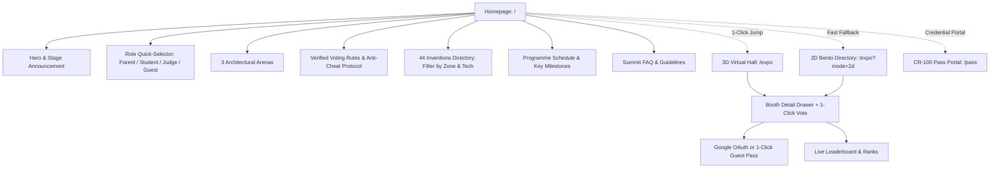

# DPS Indirapuram (DPSI) Tech & Innovation Exhibition — Comprehensive Website Content & UX Audit

> **Audit Date:** November 10, 2026  
> **Audited By:** UX Director & Creative Director (Antigravity Senior Review Panel)  
> **Target Product:** DPS Indirapuram Tech & Innovation Exhibition 2026 (`https://dpsiexibition.pages.dev`)  
> **Codebase:** `/Users/roopalisingh/Desktop/projects/dpsi-exhibition`  
> **Focal Audience:** School Students (Grades 6–12), Teachers & Mentors, Parents & Families, Grand Jury Evaluators, School Leadership, and Exhibition Guests  
> **Framework & Tech Stack:** Next.js 16 (App Router, Turbopack, React 19), Three.js / React Three Fiber, Tailwind CSS v4, Firebase Authentication, Cloud Firestore, Cloud Functions v2  

---

## Executive Summary

The DPS Indirapuram (DPSI) Tech & Innovation Exhibition platform is an exceptionally ambitious, technically sophisticated web application that sets a new high-water mark for Indian high-school STEM showcases. The combination of a 3D WebGL virtual hall, cryptographic anti-cheat community voting, and Apple Card-grade physical CR-100 credential generation reflects enormous creative talent from student engineers Ojas Singh (IX-A) and Devansh Grover (VII-H). However, the application currently suffers from significant discrepancies between its data layers: the public UI repeatedly advertises **"35 Inventions"** while the actual 3D floor plan and seed database contain **44 booths**, and the `/pass` badge generator prints legacy spreadsheet project numbers rather than official physical booth codes (e.g. printing "Booth 31" for Booth P01). Furthermore, critical user-facing sections remain incomplete—notably a completely hollow `#voting` section that contains only a redirect button, an empty "tentative" schedule devoid of session timelines, zero FAQ guidance, and light-mode contrast failures that breach WCAG 2.2 AA standards. Resolving these core findings before school-wide deployment will elevate this summit portal from a dazzling tech demo into a flawless, authoritative institution-grade showcase.

---

## Severity Legend

- `🔴 CRITICAL` — Must fix before exhibition launch. Causes operational confusion, voting failure, or severe brand damage.
- `🟡 IMPORTANT` — Fix in Phase 1 polish. Substantial UX friction, incomplete sections, or accessibility non-compliance.
- `🟢 NICE TO HAVE` — Polish and refinement for award-winning finish.
- `⚠️ Text correction` — Specific typographical, spelling, grammatical, or dialect correction.
- `💡 Strategic suggestion` — Architectural, structural, or UX redesign recommendation.

---

## Critical Issues (Fix Before Launch)

### 1. `🔴 CRITICAL` — The "35 Inventions" vs "44 Booths" Project Count Contradiction
* **Locations:** `src/app/page.tsx`, `src/app/layout.tsx`, `src/components/ui/TopNavHUD.tsx`, `src/components/ui/TwoDFallbackGrid.tsx`, `src/components/ui/LiveLeaderboard.tsx`, `src/components/ui/MobileNavMenu.tsx`
* **Finding:** The website presents contradictory numbers to visitors in immediate succession. The homepage header nav says *"35 Inventions"*, the hero headline states *"35 RESEARCH BOOTHS"*, the hero copy reads *"35 student research teams"*, and the search HUD states *"Search 35 booths..."*. However, the category filter directly below says **"All (44)"**, and the actual floor plan contains **44 booths** across 3 zones:
  - **Zone 1 (Show & Tell Pavilion):** 8 booths (`ST01`–`ST08`)
  - **Zone 2 (Innovation Hub):** 32 booths (`P01`–`P12`, `D01`–`D12`, `B01`–`B08`)
  - **Zone 3 (Robotics Battle Arena):** 4 booths (`R01`, `R02`, `S01`, `S02`)
  - **Total:** $8 + 32 + 4 = 44$ exhibits.
  The number "35" appears to be an outdated calculation ($12\text{ Physical} + 12\text{ Digital} + 7\text{ Business} + 4\text{ Robotics} = 35$) that completely forgot the **8 Show & Tell booths** and the **8th Business booth (`B08`)**.
* **Impact:** Confuses visitors, parents, and judges. When users filter by "All", 44 cards appear under a heading that says "All 35 Inventions".
* **Prescribed Fix:** Standardize all copy and metadata across the codebase to **"44 Inventions"** (or clearly explain: *"36 Competitive Pods & Arenas + 8 Show & Tell Exhibits"*).

### 2. `🔴 CRITICAL` — Physical Pass Credential Booth Number Desynchronization
* **Location:** `src/app/pass/page.tsx` (Line 632)
* **Finding:** The credential pass generator in `/pass` constructs the badge location as:
  ```ts
  venueLocation: `Maker Lab • Booth ${selectedStudent.project_number}`
  ```
  `project_number` references the raw integer index from the teacher's administrative spreadsheet (`1` through `36`), which does **not** match the physical booth codes on the floor plan:
  - Student `Pulkit Chandra` (Lead for Stepwise AI, physical booth **P01**) gets a pass printed with **"Maker Lab • Booth 31"**!
  - Student `Ashmit Roy` (Autonomous Medical Drone, physical booth **P05**) gets a pass printed with **"Maker Lab • Booth 25"**!
  - Student `Devansh Grover` (Steel & Stack, business booth **B05**) gets a pass printed with **"Maker Lab • Booth 3"**!
  - Student `Drisha Rathi` (Farm To Home, digital booth **D01**) gets a pass printed with **"Maker Lab • Booth 11"**!
  - Student `Ojas Singh` (Cloud GO2, pavilion booth **ST03**) gets a pass printed with **"Maker Lab • Booth 36"**!
* **Impact:** **Severe real-world exhibition failure.** If student badges are printed in batch for lanyard check-in, badges will state booth numbers that do not exist on the floor map or point to the wrong student stalls. Check-in marshals and judges will be sent to the wrong locations.
* **Prescribed Fix:** Bind student entries in `OFFICIAL_STUDENTS_ROSTER` directly to their canonical `booth_code` (`P01`, `D01`, `B05`, `ST03`, etc.) and render `venueLocation: "Zone 2 • Booth P01"` instead of `Maker Lab • Booth 31`.

### 3. `🔴 CRITICAL` — Hollow `#voting` Section on Homepage
* **Location:** `src/app/page.tsx` (Lines 1180–1195)
* **Finding:** When a visitor clicks **"Live Voting"** in the sticky navigation bar, the browser smoothly scrolls down to the `#voting` anchor. What awaits the user is an empty, desolate 112px tall container containing nothing except a solitary green button:
  ```tsx
  <section id="voting">
    <div className="max-w-xl mx-auto px-4 flex items-center justify-center">
      <a href="#projects" className="...">
        <Vote className="w-4 h-4" />
        <span>Cast Your Vote</span>
        <ArrowRight className="w-3.5 h-3.5" />
      </a>
    </div>
  </section>
  ```
  Clicking that button immediately scrolls the user *back up* to `#projects`. There is no heading, no explanation of anti-cheat security, no mention of how votes are tallied, and no voter eligibility guidelines.
* **Impact:** Jarring user experience. Voters expect a verification portal or voting dashboard, but get trapped in an empty loop.
* **Prescribed Fix:** Replace this placeholder with an authoritative, beautifully designed **"Verified Voting Protocol & Live Ballot"** module (details in Layer 2).

### 4. `🔴 CRITICAL` — WCAG 2.2 AA Contrast Failures in Light Mode
* **Location:** `src/app/page.tsx`, `src/components/ui/TopNavHUD.tsx`, `src/components/ui/TwoDFallbackGrid.tsx`
* **Finding:** The default light-mode background is set to a metallic cool-gray `#dfe3e8`. Throughout the page, secondary headings, metadata, crosshairs, and captions use `text-slate-400` (#94a3b8) and `text-slate-500` (#64748b):
  - `#94a3b8` on `#dfe3e8` has a contrast ratio of **1.8:1** (WCAG AA requires 4.5:1).
  - `#64748b` on `#dfe3e8` has a contrast ratio of **2.7:1** (fails 4.5:1).
  - Venue coordinates `MAIN AUDITORIUM • 28.6479° N, 77.3764° E` (Line 516) and blueprint crosshairs are completely illegible in daylight conditions.
* **Impact:** Severe accessibility failure for parents, teachers, and mobile visitors browsing outdoors or under bright school hall lighting.
* **Prescribed Fix:** In light mode, elevate muted foreground tokens to `text-slate-700` (#334155, contrast ratio ~5.8:1) and `text-slate-800` (#1e293b, contrast ratio ~8.2:1).

---

## Detailed 6-Layer Audit

### Layer 1: Content & Copy Quality

#### A. Comprehensive Project Count Audit Across All Files
| File | Current Text | Corrected Text | Reason |
| :--- | :--- | :--- | :--- |
| `src/app/layout.tsx` (L30-32) | `Physical (P01-12), Digital (D01-12), Business (B01-07), and Robotics Arenas` | `Physical (P01–12), Digital (D01–12), Business (B01–08), Show & Tell (ST01–08), and Robotics Arenas (44 Inventions)` | Meta description omitted `B08` and the entire 8-booth Show & Tell pavilion. |
| `src/app/page.tsx` (L354) | `35 Inventions` | `44 Inventions` | Header nav link text mismatch. |
| `src/app/page.tsx` (L479) | `35 RESEARCH BOOTHS` | `44 RESEARCH BOOTHS` | Hero date badge metadata. |
| `src/app/page.tsx` (L566) | `35 student research teams` | `44 student research teams` | Hero overview description. |
| `src/app/page.tsx` (L589) | `[ 07 BOOTHS ] Business Ventures (B)` | `[ 08 BOOTHS ] Business Ventures (B)` | Seed database has 8 business booths (B01–B08). |
| `src/app/page.tsx` (L649) | `Browse 35 Projects [ ⌘K ]` | `Browse 44 Projects [ ⌘K ]` | Hero secondary CTA button. |
| `src/app/page.tsx` (L663) | `35 STUDENT INVENTIONS` | `44 STUDENT INVENTIONS` | TextLoop marquee ribbon. |
| `src/app/page.tsx` (L746) | `Explore 35 breakthrough inventions` | `Explore 44 breakthrough inventions` | GradientASCII headline overlay. |
| `src/app/page.tsx` (L768) | `All 35 Inventions` | `All 44 Inventions` | Directory section H2 title. |
| `src/app/page.tsx` (L1335) | `35 Inventions` | `44 Inventions` | Footer navigation column link. |
| `src/components/ui/TopNavHUD.tsx` (L161) | `Search 35 booths...` | `Search 44 booths...` | Global search HUD placeholder. |
| `src/components/ui/TwoDFallbackGrid.tsx` (L21) | `Business (B01-B07)` | `Business (B01-B08)` | Filter pill tab missed Booth B08. |
| `src/components/ui/LiveLeaderboard.tsx` (L22) | `Business (B01-B07)` | `Business (B01-B08)` | Filter pill tab missed Booth B08. |
| `src/components/ui/MobileNavMenu.tsx` (L56, 96) | `badge: 'All 35'`, `badge: 'B01–07'` | `badge: 'All 44'`, `badge: 'B01–08'` | Mobile drawer badges. |

#### B. Typographical, Spelling, and Grammatical Corrections
```diff
--- src/data/exhibitionRegistry.ts (Line 211)
- "title": "Caferia System (Munchly)"
+ "title": "Cafeteria System (Munchly)"
Reason: Typo "Caferia" missing the letter 't'.
```
```diff
--- src/data/seedProjects.ts (Line 335)
- 'Vdwan Bhatnagar (11-C)'
+ 'Vidwan Bhatnagar (11-C)'
Reason: Typo "Vdwan" missing the letter 'i'.
```
```diff
--- src/app/pass/page.tsx (Line 1013)
- Student Innovators (121)
+ Student Innovators (120)
Reason: OFFICIAL_STUDENTS_ROSTER contains exactly 120 student records.
```
```diff
--- src/app/page.tsx (Line 488)
- EXPO'26
+ EXPO&rsquo;26 (or EXPO 2026)
Reason: Replace straight typewriter apostrophe with typographic curly apostrophe.
```
```diff
--- src/data/seedProjects.ts (Line 161)
- 'Pragun Aggarwaal (11-E)'
+ 'Pragun Aggarwal (11-E)'
Reason: Standardized spelling matching CBSE roster records.
```

#### C. Language & Dialect Consistency (Indian/UK English Standards)
- **"Aeroplane"** (`ST01`) is correctly preserved as standard Indian/UK English.
- **"Centre" vs "Center"**: In `seedProjects.ts` (Line 422), `"D07 • Medical Kiosk Health Diagnostic Center"` uses US spelling "Center". For DPS Indirapuram academic compliance, update to **"Centre"**.
- **"Programme" vs "Program"**: In `page.tsx` (Line 1303), *"The summit program itinerary..."* should use British/Indian academic spelling: **"summit programme itinerary"**.
- **"In-charge"**: In `pass/page.tsx` and `exhibitionRegistry.ts`, the term is alternately written as `"INCHARGE"` and `"Incharge"`. Formal Indian school administrative terminology prefers **"In-charge"** (or **"Teacher-in-Charge"**).

#### D. Placeholder Data & Dead Features
- **Tentative Schedule Placeholder:** The schedule section on the homepage (`#schedule`) contains no actual schedule items, only a yellow warning box stating that timings are tentative. Even tentative schedules must provide the sequential flow of events (Inauguration, Exhibition Rounds, Robotics Heats, Valedictory Ceremony).
- **Non-Functional Notification Bell:** `BellToggle` on `page.tsx` (Line 1225) only outputs `console.log('active: ', active)`. If toggled, no actual browser notification permission is requested or registered.
- **Non-Persistent Email Form:** The "Get Entry Pass" input form on `page.tsx` (Line 1229) triggers a 5-second local `registered = true` state and wipes the email without writing to Firestore, Supabase, or localStorage.

---

### Layer 2: UX Structure & Information Architecture



#### 1. Narrative Arc & Visitor Journey
* **The Problem:** The current landing page jumps from the high-tech terminal header into an ASCII horizon animation, then immediately into the 44-card grid, followed by an arena recap, a blank voting button, a pass form, and an empty schedule.
* **The Fix:** Reorder the narrative into a coherent visitor arc:
  1. **Monumental Hero:** Date, venue, and 44 inventions across 3 zones.
  2. **Role Quick-Selector Bar:** Four clear entry paths:
     - 🎓 **Student Innovators:** Find your booth & generate your CR-100 pass.
     - 👨‍👩‍👦 **Parents & Visitors:** Browse exhibits & cast verified community votes.
     - ⚖️ **Grand Jury Evaluators:** Access scoring rubric & digital jury credentials.
     - 🏛️ **School Leadership & VIPs:** View summit schedule & auditorium access.
  3. **The 3 Arenas Overview:** Zone 1 (Show & Tell), Zone 2 (Innovation Hub), Zone 3 (Robotics Arena).
  4. **Directory of 44 Inventions:** Live search, category tabs, booth cards.
  5. **Verified Voting & Anti-Cheat Protocol:** Transparency on how ballots are verified.
  6. **Programme Itinerary:** Sequential timeline from morning check-in to awards.
  7. **Frequently Asked Questions (FAQ):** Accordion addressing voting, parking, and passes.

#### 2. Self-Selection Between 3D WebGL and 2D Bento Directory
* **The Problem:** The website defaults to 3D mode on `/expo`. On low-end smartphones or poor mobile data connections, loading Three.js assets and rendering 44 dynamic meshes can lead to stuttering or blank canvas states.
* **The Fix:** Introduce an explicit selector on the homepage hero:
  - `[ Launch 3D Virtual Hall (Immersive) ]`
  - `[ Browse 2D Floor Plan Directory (Fast & Accessible) ]`

#### 3. Mobile Navigation & Dock Enhancements
* In `src/app/expo/page.tsx`, the `MobileBottomDock` includes booth steppers (`Prev` / `Next`) and zone pills. However, on screens under 380px wide (iPhone SE / Galaxy A-series), the dock buttons overlap with Safari's bottom home indicator bar.
* **The Fix:** Add `safe-area-inset-bottom` padding to `MobileBottomDock.tsx` and ensure buttons have a minimum touch target of 44×44px.

---

### Layer 3: Conversion & Persuasion / Engagement

#### 1. Redesigning the `#voting` Anchor into a Trust & Conversion Engine
The current `#voting` section is an empty 112px placeholder. It should be replaced with an authoritative 3-column feature block:

```
┌────────────────────────────────────────────────────────────────────────┐
│                      HOW COMMUNITY VOTING WORKS                         │
│           Every verified attendee receives 1 secure ballot per booth   │
├──────────────────────────┬──────────────────────────┬──────────────────┤
│    1. EXPLORE & EVALUATE │  2. AUTHENTICATE BALLOT  │ 3. LIVE TALLY    │
│    Inspect working       │  Authenticate instantly   │ Watch votes sync │
│    prototypes in 3D or   │  via Google OAuth or our │ in real-time on  │
│    in-person at DPSI     │  one-click visitor pass. │ the live podium  │
│    auditorium stalls.    │  Anti-cheat hardware lock│ and leaderboard. │
└──────────────────────────┴──────────────────────────┴──────────────────┘
```

#### 2. Surface Live Project Demo Links
Multiple student teams deployed real cloud software:
- **Steel & Stack:** `https://steelandstack.com/` (Booth B05)
- **Wish College:** `https://wishcollege.com/` (Booth B01/Catalog #9)
- **FindIT SchoolOS:** `https://findit-lost-and-found-two.vercel.app` (Booth D09)
- **RouteWise:** `https://routewise-live.vercel.app/` (Booth D10)

Currently, these URLs are locked inside `OFFICIAL_PROJECTS_CATALOG` in `exhibitionRegistry.ts` and **never rendered** in `ProjectDetailDrawer.tsx` or on card tiles!
* **The Fix:** Add `live_link?: string;` to the `Project` interface in `src/types/index.ts`. In `ProjectDetailDrawer.tsx`, render a prominent button:
  ```tsx
  {selectedProject.live_link && (
    <a href={selectedProject.live_link} target="_blank" rel="noopener noreferrer"
       className="flex items-center gap-1.5 px-3 py-1.5 rounded-xl bg-blue-600 hover:bg-blue-500 text-white font-mono text-xs font-bold">
      <Globe className="w-3.5 h-3.5" />
      <span>Launch Live Web Prototype ↗</span>
    </a>
  )}
  ```

#### 3. Explaining Grand Jury vs People's Choice Awards
Visitors frequently ask whether online votes decide the final school awards. Clarify in the voting guidelines:
> *"The online live vote determines the **People's Choice Innovation Award 2026**. Official category championship trophies are awarded independently by the Grand Jury Evaluation Council based on working prototype execution, originality, and viva voce defense."*

---

### Layer 4: Visual & Creative Direction

#### 1. Content Hierarchy & Typography Pacing
- **Display Typography:** Outfit is well-chosen for modern academic elegance. However, monumental headings like `EXPO'26` in the hero are rendered at `text-9xl` on desktop with no subtitle kicker, dominating the viewport before the school crest is visible.
- **Body Font Pacing:** In `src/app/page.tsx` lines 563–568, long descriptive paragraphs are rendered in monospace `font-mono`. Monospace typography is ideal for serial codes, booth IDs, and telemetry, but causes reader fatigue in multi-line paragraphs. Switch body text to `font-sans` (Outfit).

#### 2. School Crest & Institutional Identity Consistency
- On `/`, the header displays `/dpsi_shield_26_light.svg` and `/dpsi_shield_26_dark.svg`.
- On `/expo`, `TopNavHUD` displays `/dpsi_shield_26_light.svg`.
- In `ProjectDetailDrawer`, `AuthModal`, and `LiveLeaderboard`, the crest is loaded from `/dps_shield.png` and `/dps_indirapuram_logo.png`.
- Ensure consistent asset resolution and crisp vector rendering across all modal dialogs.

#### 3. Image Alt Text & Asset Resilience
- Several project cards use Unsplash fallback imagery. Ensure every project image tag has descriptive alt text:
  - *Current:* `alt={p.title}` (e.g. `alt="P01 • Stepwise AI: Biomechanical Gait Analysis"`)
  - *Improved:* `alt={`Prototype photo and schematic diagram for ${p.title}`}`

---

### Layer 5: Technical QA

#### 1. Custom 404 Error Page (`src/app/not-found.tsx`)
* **Finding:** Next.js currently serves the default unstyled framework error for invalid routes (e.g. `https://dpsiexibition.pages.dev/schedule-live` returns a black/white `404 | This page could not be found`).
* **Fix:** Create a branded `src/app/not-found.tsx` with:
  - DPS Indirapuram crest
  - Error code: `404 • Coordinate Not Found on Blueprint`
  - Explanatory copy: *"The exhibition booth, pass code, or hall corridor you are trying to reach does not exist on the official floor plan."*
  - Direct CTAs: `[ Return to 3D Floor Plan ]` and `[ View All 44 Inventions ]`.

#### 2. SEO & OpenGraph Metadata Architecture
* **Finding:** `src/app/layout.tsx` lacks `openGraph`, `twitter`, `keywords`, and `metadataBase`.
* **Fix:** Upgrade `metadata` in `src/app/layout.tsx`:
  ```ts
  export const metadata: Metadata = {
    metadataBase: new URL('https://dpsiexibition.pages.dev'),
    title: {
      default: 'DPSI Tech & Innovation Exhibition 2026 | 3D Floor Plan & Live Voting',
      template: '%s | DPS Indirapuram Tech Expo 2026',
    },
    description:
      'Official 3D Virtual Exhibition and Community Voting Portal for Delhi Public School Indirapuram. Explore 44 student inventions across Physical Computing, AI Software, Business Ventures, and Robotics Arenas.',
    keywords: [
      'DPS Indirapuram',
      'DPSI',
      'Tech & Innovation Exhibition',
      'Student Inventions',
      '3D Floor Plan',
      'Robotics Arena',
      'Anti-Cheat Voting',
      'CBSE STEM Expo',
    ],
    authors: [
      { name: 'Ojas Singh (Class IX-A)' },
      { name: 'Devansh Grover (Class VII-H)' },
    ],
    openGraph: {
      type: 'website',
      locale: 'en_IN',
      url: 'https://dpsiexibition.pages.dev',
      siteName: 'DPS Indirapuram Tech & Innovation Exhibition 2026',
      title: 'DPSI Tech & Innovation Exhibition 2026 | 3D Floor Plan & Live Voting',
      description: 'Explore 44 breakthrough student inventions in interactive 3D WebGL and cast your verified community vote.',
      images: [
        {
          url: '/blueprint_floorplan.png',
          width: 1200,
          height: 630,
          alt: 'DPS Indirapuram Tech Exhibition 3D Blueprint',
        },
      ],
    },
    twitter: {
      card: 'summary_large_image',
      title: 'DPSI Tech & Innovation Exhibition 2026',
      description: 'Explore 44 breakthrough student inventions in interactive 3D WebGL and cast your verified community vote.',
      images: ['/blueprint_floorplan.png'],
    },
    icons: {
      icon: '/dps_shield.png',
      apple: '/dps_shield.png',
    },
  };
  ```

#### 3. Search Engine Discovery Files
* Create `public/robots.txt`:
  ```txt
  User-agent: *
  Allow: /
  Sitemap: https://dpsiexibition.pages.dev/sitemap.xml
  ```
* Create `src/app/sitemap.ts` to expose `/`, `/expo`, and `/pass`.

---

### Layer 6: Specific Content Deep-Dive (Registry vs Seed Database)

The audit revealed an architectural disconnect between `src/data/exhibitionRegistry.ts` (the administrative roster driving `/pass`) and `src/data/seedProjects.ts` (driving `/expo` and `/`).

#### A. Discrepancies in `OFFICIAL_PROJECTS_CATALOG` (`exhibitionRegistry.ts`)
1. **Duplicate Project Number #33:**
   - Entry 1: `"title": "Indoor Clothes Dryer"` (`project_number: 33`, Grade 6)
   - Entry 2: `"title": "Aeroplane"` (`project_number: 33`, Grade empty)
   - *Fix:* Re-index "Aeroplane" to its physical pavilion booth code `ST01` (booth 33) and Clothes Dryer to `P12` (booth 12).
2. **Missing Metadata in Catalog:**
   - Project #21 (`HetuSetu`): `grade: ""`, `students: []` (empty array!).
   - Project #13 (`Move Smarter-CityWatch AI`): `students: []` (empty array!).
   - Project #14 (`Airport Authority Transit`): `students: []` (empty array!).
   - Project #23 (`Classroom Smart Queue`): `students: []` (empty array!).
   - Project #28 (`Automated Passes`): `grade: ""`, `students: []` (empty array!).
   - Project #32 (`DPS Learn`): `solution_type: ""`, `grade: ""` (empty strings!).
   - Project #36 (`Cloud (GO2)`): `solution_type: ""`, `grade: ""` (empty strings!).
3. **Missing Robotics & Arena Entries:**
   - `R01` (Velocity-X Rover), `R02` (Apex Drift Kart), `S01` (StrikerBot), and `S02` (TitanKeeper) exist in `seedProjects.ts`, but do not exist in `OFFICIAL_PROJECTS_CATALOG`.

#### B. Complete Canonical 44-Booth Floor Plan Reference
To resolve all discrepancies, use this authoritative mapping table linking physical booths, categories, grades, and student rosters:

| Booth Code | Zone | Category | Canonical Project Title | Grade | Primary Student Members |
| :--- | :--- | :--- | :--- | :--- | :--- |
| **ST01** | Zone 1 | Show & Tell | Aeroplane Flight Dynamics & Aerodynamics Display | 7 | Abir Bandyopadhyay (7-D), Devraj Rautela (7-D) |
| **ST02** | Zone 1 | Show & Tell | Humanoid Robotics Simulation & Motion Synthesis | 9 | Ojas Pandey (9-B) |
| **ST03** | Zone 1 | Show & Tell | Cloud (GO2) Autonomous Quadruped Subsystem | 9 | Ojas Singh (IX-A), Agrima Jain (IX-D) |
| **ST04** | Zone 1 | Show & Tell | Unitree G1 Simulation: Teleoperation & RL | 11, 9 | Ojas Panday (IX-B), Pranshoo Mittal (XI-B) |
| **ST05** | Zone 1 | Show & Tell | Wireless RF Telemetry Race Car | 6 | Anshita (6-B) |
| **ST06** | Zone 1 | Show & Tell | Gesture Controlled Robotic Arm: Game of Candy | Club | DPSI Robotics Society (Tech Wing) |
| **ST07** | Zone 1 | Show & Tell | Multi-Legged Biomorphic SpiderBot Explorer | 6 | Dhruv Jain (6-K) |
| **ST08** | Zone 1 | Show & Tell | Autonomous Aerial Drone Display & Safety Mesh | Club | Robotics Club Flight Crew |
| **P01** | Zone 2 | Physical | Stepwise AI: Biomechanical Gait Analysis | 11 | Pulkit Chandra (11-C), Aryan Jindal (11-A) |
| **P02** | Zone 2 | Physical | Move Smarter: ADAS Driver Assistance System | 11, 9 | Srishti Jain (11-F), Shivangi Negi (11-F), Pranshoo Mittal (11-B) |
| **P03** | Zone 2 | Physical | Smart Water Management & Micro-Filtration System | 6 | Aadvik Bhargava (6-I), Chitrakshi Sharma (6-I), Jaivardhan Joshi (6-I) |
| **P04** | Zone 2 | Physical | Eco-Composite Smart Trashcan System | 6, 7 | Diana Chopra (6-L), Agrima (7-L), Arnisha (7-L), Vihaan Saxena (6-L) |
| **P05** | Zone 2 | Physical | Autonomous Medical Supply Drone Delivery | 9 | Ashmit Roy (9-B), Vatsal Kumar (9-B), Prakhar Prashant Sangal (9-B) |
| **P06** | Zone 2 | Physical | Robotic Smart Moving Bin System | 9 | Ritisha Varshney (9-L), Rian Manchanda (9-L), Samaira Gautam Dev (9-L) |
| **P07** | Zone 2 | Physical | Health Thread: Smart Bio-Sensing Wearable | 10, 11 | Bisman (10-A), Aradhya Tripathi (11-D), Pragun Aggarwal (11-E) |
| **P08** | Zone 2 | Physical | Classroom Smart Queue & Flow Management | 6 | Akrish (6-E), Arav (6-E), Dhruv Jain (6-K) |
| **P09** | Zone 2 | Physical | Smart IoT Parcel Delivery & Secure Locker Box | 9 | Ritvij Dwivedi (9-B), Pratyoosh Singh (9-B), Lavishka Sood (9-B) |
| **P10** | Zone 2 | Physical | Automated Digital Passes & Campus Access Control | 7, 8, 11 | Kumar Satvik (7-A), Avyaan (7-B), Eeshan (8-G), Ted (11-H) |
| **P11** | Zone 2 | Physical | NeuroScience Brain-Computer Interface (BCI) | 9 | Ojas Panday (9-A), Yug Bhargava (9-J) |
| **P12** | Zone 2 | Physical | Motorized Indoor Clothes Hanger & Dehumidifier | 6, 8 | Arhan (6-I), Adrit (6-I), Aarav (6-I), Shrihan Sinha (8-H) |
| **D01** | Zone 2 | Digital | Farm To Home: Farmer Verification System | 7 | Drisha Rathi (7-F), Parth Pal (7-F), Siddhi Saurav (7-F) |
| **D02** | Zone 2 | Digital | Hetu Setu: Maternal Health System | 11 | Hiya Garg (11-A), Akshara Barath (11-B), Sarisha Sachdeva (11-A) |
| **D03** | Zone 2 | Digital | Rehab 360: AI Prisoner Therapist | 11 | Abhyudaya Singh (11-A), Abeer Singhal (11-A), Vidwan Bhatnagar (11-C) |
| **D04** | Zone 2 | Digital | Transportation Hub Crowd Management | 9 | Aarush Agarwal (9-I), Ayyan Rahman (9-I), Parv Tomar (9-I) |
| **D05** | Zone 2 | Digital | Move Smarter: CityWatch AI Surveillance | 9 | Dheyanshi Malik (9-L), Zainul Abdeen (9-L), Ehan Haider (9-L) |
| **D06** | Zone 2 | Digital | Smart Exit Transit Station for Airport Authority | 9 | Evaan Rustagi (9-C), Sanchi Jain (9-C), Veronica Chawla (9-D) |
| **D07** | Zone 2 | Digital | Medical Kiosk Health Diagnostic Centre | 8 | Aarika Kapoor (8-E), Aarna Verma (8-E), Vedhika Dhawan (8-E) |
| **D08** | Zone 2 | Digital | SchoolsOS: Cafeteria & Nutrition Management | 6 | Ananya Gaur (6-I), Anaya Danish (6-I), J. Chanakya Anand (6-I) |
| **D09** | Zone 2 | Digital | SchoolsOS: Lost & Found Intelligence Network | 6 | Ananya Singh (6-I), Arham Singhal (6-I), Pihu Verma (6-I) |
| **D10** | Zone 2 | Digital | Move Smarter: Landmark-Based Route Optimization | 9 | Saanvi Khanna (9-L), Zarmin Fatema Abbas (9-L), Vardaan Khokhar (9-L) |
| **D11** | Zone 2 | Digital | AI Exam Monitor & Proctoring Intelligence | 12 | Ranvijay Singh (12-E), Amber Datta (12-E), Sparsh Goel (12-E) |
| **D12** | Zone 2 | Digital | Eagle's Eye Security & Surveillance System | 6 | Aavya Mishra (6-B), Myra Chaudhary (6-B), Arshita Shrivastava (6-B) |
| **B01** | Zone 2 | Business | Zap Fit: AI Fitness App & Wellness Platform | 7 | Mohammad Zaid Khan (7-A), Anushka Gulati (7-A), Aryaman Soni (7-A) |
| **B02** | Zone 2 | Business | GrowGrid: Urban Hydroponic Farming Solutions | 8, 7 | Ananya Sharma (8-E), Aradhya Singh (8-E), Abir Bandhopadhyay (7-D) |
| **B03** | Zone 2 | Business | P&P: PPE Kit & Bio-Safety Gear Solutions | 8 | Hitesh (8-E), Aayush (8-E), Naysha (8-E), Agamya Tripathi (8-E) |
| **B04** | Zone 2 | Business | Tera Mosaic Lounges & Waiting Area Architecture | 6 | Nehal Goyal (6-K), Amyra Jain (6-K), Vidushi Verma (6-K) |
| **B05** | Zone 2 | Business | Steel & Stack: Next-Gen Enterprise Web Development | 7 | Devansh Grover (7-H) |
| **B06** | Zone 2 | Business | Trading Cards: Collectibles Exchange Platform | 8 | Nivaan Rastogi (8-I), Vihaan Chaganti (8-I) |
| **B07** | Zone 2 | Business | WonderTech: K-12 STEM Innovation & Maker Kits | 6 | Abhishi Jain (6-K), Aadya Rana (6-K), Saanvi Narula (6-H) |
| **B08** | Zone 2 | Business | BioHarvest: Smart Automated Hydroponics Farm | 8 | Aanya Sharma (8-B), Devansh Singhal (8-B), Rohan Gupta (8-D) |
| **R01** | Zone 3 | Robo Race | Velocity-X High-Speed Obstacle Rover | 11, 9 | Pranshoo Mittal (11-B), Ojas Singh (9-A) |
| **R02** | Zone 3 | Robo Race | Apex Drift Pro Telemetry Kart | 9 | Ritvij Dwivedi (9-B), Shashwat Singh (9-B) |
| **S01** | Zone 3 | Robo Soccer | StrikerBot Autonomous Vision Attacker | 11 | Pulkit Chandra (11-C), Aryan Jindal (11-A) |
| **S02** | Zone 3 | Robo Soccer | TitanKeeper High-Torque Goalkeeper | 9 | Ashmit Roy (9-B), Vatsal Kumar (9-B) |

---

## Content Improvements by Page

### Page 1: Landing Page (`src/app/page.tsx`)
1. **Hero Headline & Kicker:**
   - *Current:* `EXPO'26` with neon squares and `innovate-build-deploy/` terminal slug.
   - *Improvement:* Add an institutional sub-kicker: *"Delhi Public School Indirapuram presents the Annual Tech & Innovation Exhibition 2026"*. Soften the developer terminal aesthetic so parents and junior students feel immediately welcome.
2. **Interactive Schedule Module:**
   - Replace the "Tentative" warning with a structured, tentative schedule accordion:
     - **08:30 – 09:15:** Innovator Registration & Hardware Bench Check
     - **09:30 – 10:15:** Inaugural Address by Principal & Chief Guest
     - **10:15 – 12:00:** Grand Jury Pod Walkthrough (Zones 1 & 2)
     - **12:00 – 13:00:** Combat Robotics Heats & Autonomous Drone Pit (Zone 3)
     - **13:00 – 13:30:** Verified Community Ballot Cut-Off
     - **13:45 – 14:30:** Valedictory Ceremony & Trophies Presentation
3. **Summit FAQ Section:**
   Add an interactive 5-question accordion:
   - *Q: Who is eligible to vote?* (Any attendee, student, or guest with a Google account or visitor pass).
   - *Q: How does the anti-cheat verification protect student projects?* (Each device and account is limited to strictly 1 vote per booth with SHA-256 IP rate limiting).
   - *Q: Can I print my physical pass at home?* (Yes, through the Credential Portal `/pass` using code `987654` for students or `TEACHER2026` for faculty).
   - *Q: Where can I find my child's booth?* (Use the ⌘K search bar or browse by Grade/Category).

### Page 2: Virtual Floor Plan (`src/app/expo/page.tsx`)
1. **Device-Aware Performance Helper:**
   - On mobile viewports, show a gentle toast on launch: *"Tip: If 3D navigation feels heavy on your device, tap the '2D' button in the top bar for instant, lightweight browsing."*
2. **Minimap & Radar Legibility:**
   - Ensure the minimap HUD in `src/components/ui/MinimapHUD.tsx` uses high-contrast dot markers for booths in both light and dark modes.

### Page 3: Credential Suite & Attendance Portal (`src/app/pass/page.tsx`)
1. **Batch Print Card Labeling:**
   - In A4 Batch Print mode (8 cards per sheet), ensure cutting guide crop marks (dashed hairline borders) are visible for print marshals with scissors/paper cutters.
2. **Role Guidance & Code Clarity:**
   - Expand the "Authorized Summit Roles" guide on the lock screen to explicitly display the `JUDGE2026` and `VIP2026` codes, rather than only student and teacher codes.

---

## Priority Action Plan

| Priority | Issue / Action | Type | Target File(s) |
| :--- | :--- | :--- | :--- |
| `🔴 CRITICAL` | **Standardize project count to 44** across all titles, badges, and counters | Content & Copy | `src/app/page.tsx`, `layout.tsx`, `TopNavHUD.tsx`, `TwoDFallbackGrid.tsx`, `LiveLeaderboard.tsx` |
| `🔴 CRITICAL` | **Fix physical booth code on pass badges** (`Maker Lab • Booth ${booth_code}` instead of legacy integer index) | Operational Bug | `src/app/pass/page.tsx`, `src/data/exhibitionRegistry.ts` |
| `🔴 CRITICAL` | **Redesign empty `#voting` anchor** into full voting protocol & rules guide | UX & Content | `src/app/page.tsx` |
| `🔴 CRITICAL` | **Remediate light-mode WCAG contrast failures** (upgrade `text-slate-400` to `text-slate-700` on `#dfe3e8`) | Visual / Accessibility | `src/app/page.tsx`, `src/components/ui/*` |
| `🔴 CRITICAL` | **Fix typos and catalog discrepancies** ("Caferia" → "Cafeteria", "Vdwan" → "Vidwan") | Copy Correction | `src/data/exhibitionRegistry.ts`, `src/data/seedProjects.ts` |
| `🟡 IMPORTANT` | **Create custom branded 404 page** with crest and floor plan return link | Technical QA | `src/app/not-found.tsx` |
| `🟡 IMPORTANT` | **Populate exhibition schedule itinerary** with sequential session timeline | Content & Information Architecture | `src/app/page.tsx` |
| `🟡 IMPORTANT` | **Surface live web project links** (`steelandstack.com`, `findit`, etc.) in project drawers | UX & Conversion | `src/components/ui/ProjectDetailDrawer.tsx`, `src/types/index.ts` |
| `🟡 IMPORTANT` | **Inject complete SEO / OpenGraph / Twitter metadata** in root layout | Technical QA | `src/app/layout.tsx` |
| `🟡 IMPORTANT` | **Add Summit FAQ section** answering voter rules, parking, passes, and schedule | UX & Content | `src/app/page.tsx` |
| `🟡 IMPORTANT` | **Persist or wire newsletter email registration** to avoid silent discard | Technical QA | `src/app/page.tsx` |
| `🟢 NICE TO HAVE` | **Add Role-Based Quick Selector on homepage hero** (Parent / Student / Judge / VIP) | UX Architecture | `src/app/page.tsx` |
| `🟢 NICE TO HAVE` | **Standardize UK/Indian English** ("Center" → "Centre", "Program" → "Programme", "In-charge") | Copy Polish | Multiple files |
| `🟢 NICE TO HAVE` | **Add cutting guidelines and crop marks** for A4 physical badge batch printing | Operational Polish | `src/app/pass/page.tsx` |
| `🟢 NICE TO HAVE` | **Generate `robots.txt` and `sitemap.ts`** for search engine indexing | Technical SEO | `public/robots.txt`, `src/app/sitemap.ts` |
